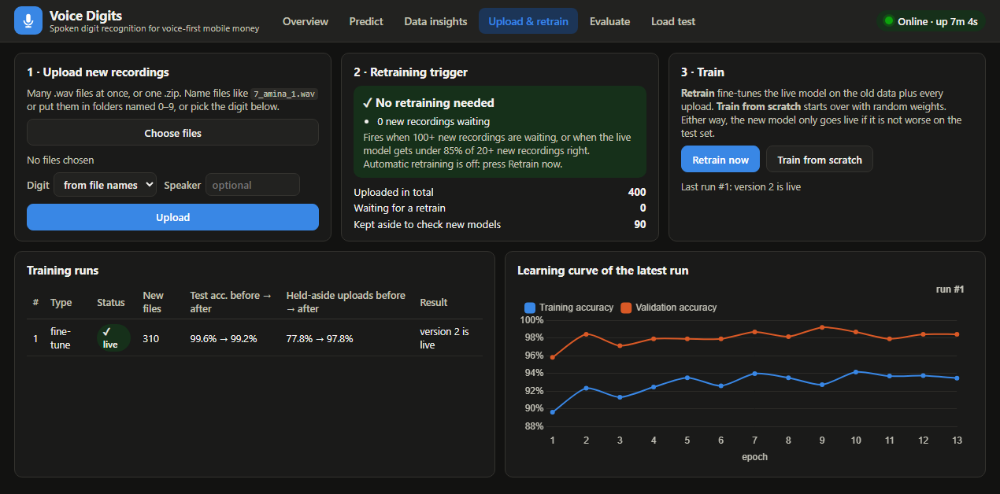
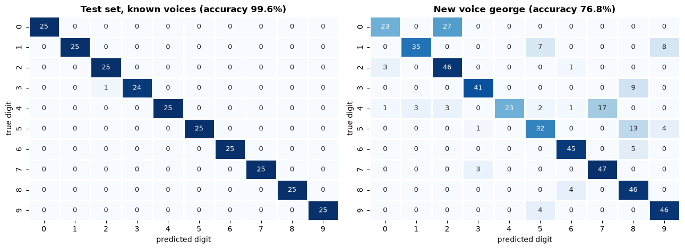
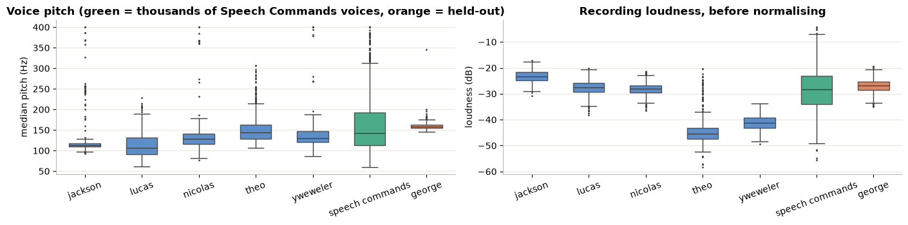
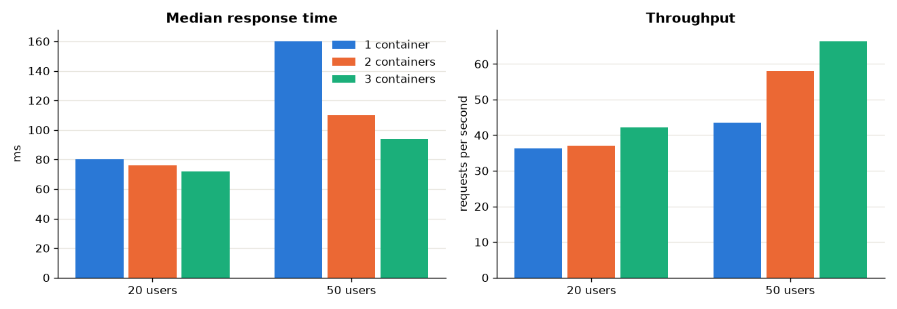

# Voice Digits: an ML pipeline for spoken digits

This project recognises a spoken digit (0 to 9) from a short recording. It is the first piece of a voice interface for mobile money. The repo covers data acquisition, preprocessing, a CNN and its evaluation, an API with a dashboard, bulk upload with a retraining trigger, Docker, cloud deployment and a load test.

| | |
|---|---|
| Video demo | YouTube: _add link_ |
| Live app | _add the Render URL (see [Deploy to the cloud](#deploy-to-the-cloud))_ |
| API docs | `<app URL>/docs` |
| Notebook | [notebook/voice_digits_pipeline.ipynb](notebook/voice_digits_pipeline.ipynb) |

## Project description

This builds on my Introduction to ML summative, which used the FinScope survey to predict who has a bank account in East Africa. Those models did worst for rural adults, women and people with little schooling, the same people financial inclusion is meant to reach. Mobile money menus (USSD and apps) assume the user can read. With a voice interface, someone can say an amount or a phone number instead, one digit at a time.

This assignment asks for data that isn't tabular, so the model works on audio: recordings of people saying the English words *zero* to *nine*. It uses two public datasets.

- [Free Spoken Digit Dataset](https://github.com/Jakobovski/free-spoken-digit-dataset) (FSDD v1.0.10, CC BY-SA 4.0) has 3,000 clean recordings of six speakers, each saying every digit 50 times.
- [Google Speech Commands v0.02](https://www.tensorflow.org/datasets/catalog/speech_commands) (CC BY 4.0) was recorded by about 2,600 people through a web page, on their own computers and phones. That is close to how the app's Record button works. Only the digit words are used: 400 clips per digit go to training, picked from as many different people as possible, and 100 per digit from the dataset's own test speakers go to the test set.

The first version used FSDD alone. It scored 99.6% on its own test set, but on a real laptop microphone it hardly ever answered 4, 5, 6 or 8. Adding Speech Commands fixed that (see [Results](#results)).

One FSDD speaker, george, is left out of training completely. That voice stands in for a new user after launch, and its recordings are used to demonstrate the upload and retraining loop.

## What the app does

| Requirement | Where |
|---|---|
| Predict one data point from a recording | Predict tab: upload a .wav, record from the microphone, or try a random test file. `POST /predict` |
| Test and teach it your own voice | My voice tab: a 10-digit test with a score, and guided recording of labelled clips that go into retraining |
| Visualisations with interpretations of 3+ features | Data insights tab (duration, zero-crossing rate, pitch and loudness per voice, mean spectrograms, class balance), and in the notebook |
| Bulk upload of new data | Upload & retrain tab: many .wav files or a .zip. `POST /upload` saves each file and a database row |
| Retraining trigger | Fires when 100 or more new recordings are waiting, or when the live model gets under 85% of them right. `GET /trigger` |
| Button to retrain | Retrain now (fine-tunes the live model) and Train from scratch. `POST /retrain` |
| Model uptime | Status pill, uptime tiles and a chart of health-check response times (one check every 5 s). `GET /health` |
| Evaluation in production | Evaluate tab: scores the live model on unseen voices, the whole test set, george or held-aside uploads. `POST /evaluate` |
| Flood test with N containers | `scripts/load_test.py` with Locust. Results are on the Load test tab and [below](#flood-request-simulation) |



## Repository structure

```
voice-digits-pipeline/
├── README.md
├── notebook/
│   └── voice_digits_pipeline.ipynb   preprocessing, training, evaluation, prediction, retraining
├── src/
│   ├── data_acquisition.py           downloads FSDD, splits into train / test / new_voice, adds Speech Commands
│   ├── speech_commands.py            downloads Speech Commands, samples the digit words, cuts noise pieces
│   ├── preprocessing.py              audio -> 40x101 log-mel spectrogram, feature extraction
│   ├── audio.py                      the audio maths in NumPy/SciPy (no librosa needed at run time)
│   ├── model.py                      CNN, training, fine-tuning (TensorFlow)
│   ├── lite.py                       light engine: the same CNN in NumPy, last-layer retraining
│   ├── metrics.py                    accuracy, precision, recall, F1, log loss, ROC AUC, confusion matrix
│   ├── prediction.py                 loads the live model, predicts one recording
│   ├── retrain.py                    upload checks, retraining trigger, retraining job
│   ├── registry.py                   model versions (which one is live)
│   ├── database.py                   SQLite: uploads, batches, training runs, evaluations, predictions
│   ├── insights.py                   feature table and chart data
│   ├── api.py                        FastAPI app (also serves the dashboard)
│   └── config.py                     paths and settings
├── ui/                               dashboard (HTML, CSS, JavaScript, Chart.js)
├── data/
│   ├── train/<digit>/*.wav           6,250: FSDD (5 speakers, takes 5-49) + 4,000 Speech Commands (7_sc-<id>_0.wav)
│   ├── test/<digit>/*.wav            1,250: FSDD takes 0-4 + 1,000 from Speech Commands test speakers
│   ├── new_voice/<digit>/*.wav       500 recordings of george, never used in the first training
│   └── noise/*.wav                   120 one-second background-noise pieces for noisy training copies
├── models/
│   ├── digit_cnn.h5                  the trained model (version 1)
│   ├── digit_cnn_info.json           its metrics and training history
│   └── lite/                         the same model as NumPy weights, plus stored embeddings
├── locust/locustfile.py              the flood of requests
├── scripts/
│   ├── load_test.py                  runs Locust against 1, 2, 3 containers
│   ├── check_api.py                  end-to-end check: predict, upload, trigger, retrain
│   ├── export_figures.py             saves the notebook's charts to results/figures/
│   ├── export_lite.py                exports the model for the light engine and checks it
│   ├── check_audio_parity.py         compares src/audio.py with librosa
│   └── make_zip.py                   zips the repo for submission
├── render.yaml                       Render settings (light engine, free plan)
├── results/                          features.csv, insights.json, figures/, load_tests/
├── Dockerfile, docker-compose.yml, nginx.conf
└── requirements.txt, requirements-api.txt, requirements-render.txt
```

## Results

All numbers come from the executed notebook. The test set has two parts. The FSDD part is other takes by speakers the model trained on, which is the easy case. The unseen part is 1,000 clips from Speech Commands speakers who are not in the training data, which is closer to what a new user brings. george is FSDD's sixth speaker, kept out of training.

| Model | FSDD voices (250) | Unseen voices (1,000) | george (500) |
|---|---|---|---|
| Baseline: logistic regression on MFCC summaries | 88.0% | 62.3% | 45.2% |
| First CNN, trained on FSDD only | 99.6% | not measured | 76.8% |
| CNN on FSDD + Speech Commands (`models/digit_cnn.h5`, v1) | 99.2% | 94.7% | 95.8% |

All metrics for the final CNN:

| | Validation | Whole test set | FSDD voices | Unseen voices | george |
|---|---|---|---|---|---|
| Accuracy | 0.953 | 0.956 | 0.992 | 0.947 | 0.958 |
| Precision (macro) | 0.954 | 0.956 | 0.993 | 0.948 | 0.962 |
| Recall (macro) | 0.953 | 0.956 | 0.992 | 0.947 | 0.958 |
| F1 (macro) | 0.953 | 0.956 | 0.992 | 0.947 | 0.958 |
| Log loss | 0.138 | 0.166 | 0.016 | 0.204 | 0.137 |
| ROC AUC (one vs rest) | 0.999 | 0.998 | 1.000 | 0.997 | 0.999 |

On unseen voices, 90% of the answers come with at least 85% confidence, and those answers are right 99% of the time. *Five* is the weakest digit (recall 0.89). Every digit has an F1 above 0.9.

### What made the difference

The FSDD-only model mostly heard 0, 3 or 7 when someone spoke into a laptop microphone. Most of the fix came from training data. 4,000 Speech Commands clips from about 2,000 different people were added, and half of the training clips also got a copy with real background noise mixed in (a running tap, dishes, an exercise bike, white and pink noise). Preprocessing changed too: a long, noisy recording now keeps its loudest second instead of its middle second, so the word doesn't get cut.

### Retraining

In the notebook, 400 of george's recordings are treated as uploads and the saved model is fine-tuned on them. The trigger fires because 400 recordings are waiting. The model already got george right before retraining, so there is little to gain: the whole test set goes from 95.6% to 95.8%, george's held-aside clips stay at 100%, and the promotion rule lets the new version go live.

The FSDD-only model shows what the loop does for a voice the model doesn't know. Run through the API with `scripts/check_api.py` (four bulk uploads of 100 files, then Retrain now), its accuracy on held-aside uploads went from 77.8% to 97.8%, while test accuracy moved only from 99.6% to 99.2%. Version 2 went live. The My voice tab runs the same loop on the user's own recordings.



### What the data says

`src/insights.py` measures a few features on every recording. The charts are in the notebook and on the dashboard's Data insights tab.

1. Duration. In FSDD's clean recordings, *zero* (median 0.49 s) and *nine* take longest to say, and *two* (0.36 s) and *one* the least. Speech Commands clips measure longer (0.64 to 0.78 s) because background noise in home recordings stops the trimmer from cutting all the silence. Only 5 of 8,000 recordings run past one second after trimming, so every clip is padded or cut to a one-second window. A long, noisy recording keeps its loudest second.
2. Zero-crossing rate. *Six* is far above every other digit (0.32, against 0.13 to 0.21 for the rest) because of its two hissing *s* sounds, followed by *five*, *eight* and *seven*. Hiss puts energy into the high bands of the spectrogram, which the CNN can see.
3. Pitch and loudness per voice. FSDD's five training voices have median pitches between 106 and 143 Hz, and george is above all of them at 158 Hz. Trained on those five alone, the CNN got 77% on george. 80% of the Speech Commands clips fall between 98 and 231 Hz, which puts george well inside the range; trained on both datasets, the CNN gets 96% on george. Loudness differs by more than 20 dB between speakers, so every clip is normalised to the same peak.



## Setting it up

You need Python 3.12 or 3.13. Docker Desktop is only needed for the container and load tests.

```bash
git clone <this repo>
cd voice-digits-pipeline
python -m venv .venv
# Windows: .venv\Scripts\activate     macOS/Linux: source .venv/bin/activate
pip install -r requirements.txt
```

The data (`data/train`, `data/test`, `data/new_voice`, `data/noise`) and the trained model (`models/digit_cnn.h5`) are already in the repo. To download the data again from scratch:

```bash
python -m src.data_acquisition      # FSDD (10 MB) + Speech Commands (2.3 GB download, keeps the digit words)
python -m src.insights              # rebuilds results/features.csv and results/insights.json
```

### Run the notebook

```bash
jupyter notebook notebook/voice_digits_pipeline.ipynb
```

Running all cells retrains the CNN and overwrites `models/digit_cnn.h5`. That took about 50 minutes on a laptop CPU and is much faster on Colab. The seed is fixed (`SEED = 42`), but TensorFlow on CPU isn't exactly repeatable, so a re-run can differ by a few tenths of a percent.

### Run the API and dashboard

```bash
uvicorn src.api:app --port 8000
```

The dashboard is at http://localhost:8000 and the API docs at http://localhost:8000/docs. Uploads, the SQLite database and retrained models go to `storage/`. Set the `STORAGE_DIR` environment variable to put them somewhere else.

To check the whole pipeline end to end (predict, bulk upload, trigger, retrain, promotion), start the API on an empty storage folder and run:

```bash
python scripts/check_api.py --host http://localhost:8000
```

### Run several containers behind a load balancer

```bash
docker compose up -d --build --scale api=3
```

The dashboard is then at http://localhost:8080. nginx sends requests to the containers in turn. All containers share one volume for uploads, the database and model versions, so a model retrained in one container goes live in all of them. Each container is limited to 1 CPU and 1.5 GB, and one uses about 700 MB when idle.

### Demo: retraining on a new voice

1. My voice tab: type a name and press Start the test. You get a score for your own voice.
2. If some digits miss, press Start recording under Teach it your voice. It asks for each digit a few times and saves every clip with its label.
3. Press Retrain on my voice. The Upload & retrain tab shows the progress bar, and when the run finishes the runs table shows accuracy before and after on the test set and on your held-aside clips.
4. Take the test again.

Bulk upload works the same way. Zip the `data/new_voice` folder (Windows: right-click, then *Send to*, then *Compressed (zipped) folder*), choose the zip in the Upload & retrain tab and press Upload. The digit is read from each file name (`7_george_32.wav`). The trigger box then says whether retraining is recommended, and why.

## How retraining works

1. Upload. Each file must be readable audio with speech in it and no longer than 3 seconds. The digit comes from the form or from the file name, and duplicates are caught by checksum. The file goes to `storage/uploads/<digit>/` with a row in the `uploads` table. About one file in five is marked as holdout and never trained on. Those files show whether a retrained model really learned the new voice.
2. Trigger. After every upload the live model predicts the waiting recordings. It asks for retraining when 100 or more are waiting, or when it gets fewer than 85% of them right (checked once 20 are in). The dashboard shows the reason. With `AUTO_RETRAIN=1` the job also starts by itself.
3. Job. A background thread loads the live model and fine-tunes it: Adam at learning rate 3e-4, up to 15 epochs, early stopping. It trains on the original data plus every upload that isn't held out, and uploads count up to 5 times as much as an original clip. Half the training clips get a noisy copy, as in the first training. Because the job starts from the live model, it learns the new voices without forgetting the old ones. Train from scratch runs the full training (up to 50 epochs) on the same data.
4. Promotion. The new model is saved as a new version either way. It goes live only if its test accuracy drops by no more than 2 points and it is not worse on the holdout uploads. Otherwise the old model stays live and the run is marked *kept old*. Every run is logged in `training_runs`, and `POST /model/activate` makes any saved version live again.

On a small server the light engine does a lighter version of step 3: it keeps the network fixed and retrains only the last layer (see [Deploy to the cloud](#deploy-to-the-cloud)).

Settings are environment variables: `ENGINE` (`tensorflow` or `lite`; the default is tensorflow when it is installed), `RETRAIN_MIN_NEW_SAMPLES` (100), `RETRAIN_ACCURACY_TRIGGER` (0.85), `RETRAIN_MIN_FOR_ACCURACY` (20), `AUTO_RETRAIN` (0), `MAX_TEST_DROP` (0.02) and `PREDICT_CONCURRENCY` (2). The last one is how many predictions a container runs at the same time; the rest wait in line.

## API

| Method | Path | What it does |
|---|---|---|
| GET | `/health` | status, uptime, live model version, requests served, container name |
| POST | `/predict` | form field `file`: one recording → digit, word, confidence, all 10 probabilities, latency |
| GET | `/sample?dataset=test\|new_voice` | a random labelled recording |
| GET | `/model` | live model info, metrics, history, all versions |
| POST | `/model/activate` | form field `version`: make an older or newer version live |
| POST | `/evaluate?dataset=unseen\|test\|new_voice\|uploads` | all metrics for the live model on that set |
| GET | `/insights` | data for the charts |
| POST | `/upload` | form fields `files` (many), `label` (0-9 or auto), `speaker` |
| GET | `/uploads` | upload totals and recent batches |
| GET | `/trigger` | whether retraining is needed and why |
| POST | `/retrain` | form field `mode`: `retrain` (fine-tune) or `train` (from scratch) |
| GET | `/retrain/status` | the running or last run, with progress, and recent runs |
| GET | `/stats` | prediction count, latency, per container |
| GET | `/load-tests` | the saved load test summary |

## Flood request simulation

Locust sent `POST /predict` requests (each one uploads a random test recording) for 60 seconds per run, to 1, 2 and 3 API containers behind nginx. Each simulated user waited only 0.1 to 0.5 s between requests. Each container was capped at 1 CPU and ran at most 2 predictions at a time. These runs were made on 2026-11-23 with the FSDD-only model. The second dataset changed the network's weights but not its size or the preprocessing, so each request costs the same.

| Containers | Users | Requests | Failures | Requests/s | Median | Average | 95th pct | 99th pct |
|---|---|---|---|---|---|---|---|---|
| 1 | 20 | 2,017 | 0 | 36.3 | 80 ms | 164 ms | 490 ms | 1.9 s |
| 2 | 20 | 2,095 | 0 | 37.1 | 76 ms | 158 ms | 500 ms | 2.0 s |
| 3 | 20 | 2,378 | 0 | 42.2 | 72 ms | 99 ms | 250 ms | 0.7 s |
| 1 | 50 | 2,530 | 0 | 43.5 | 160 ms | 704 ms | 3.3 s | 6.7 s |
| 2 | 50 | 3,338 | 4 | 58.0 | 110 ms | 430 ms | 2.1 s | 4.2 s |
| 3 | 50 | 3,890 | 1 | 66.3 | 94 ms | 356 ms | 1.6 s | 3.4 s |



One container tops out at about 43 requests per second. At 50 users it is saturated: requests queue, the median doubles from 80 to 160 ms, and the slowest 5% wait more than 3 seconds.

Adding containers raises capacity and cuts the waiting. At 50 users, going from 1 to 3 containers gives 52% more throughput (43.5 to 66.3 requests/s), a 41% lower median (160 to 94 ms) and roughly half the 95th-percentile latency (3.3 to 1.6 s). At 20 users one container isn't saturated yet, so a second one adds little (median 80 to 76 ms) and the third mostly trims the slow tail (95th percentile 490 to 250 ms).

Only 5 of the 16,248 requests failed, all of them connection resets under the heaviest load. The third container helped less than the second because everything ran on one laptop: Locust, nginx and three TensorFlow containers shared the same CPUs and 7.7 GB of RAM.

The laptop had less than 1 GB of RAM free, so the script also logged free RAM and Windows paging during each run (`results/load_tests/summary.md`). The first attempt collapsed. Other apps and services were still open, and each container ran every request at once, so one container at 100 users served 51 requests in a minute. Closing the other apps and letting each container run only 2 predictions at a time (`PREDICT_CONCURRENCY`) made the results usable. That limit is also the right setting in production, since running more threads than there are CPUs only adds switching overhead.

To run it yourself, with Docker Desktop running:

```bash
python scripts/load_test.py --containers 1 2 3 --users 20 50 --seconds 60
```

For each container count, the script starts fresh containers, waits until all of them answer, runs Locust headless and saves `results/load_tests/summary.json`, `summary.md` and `latency.png`. Locust's own web UI also works: run `locust -f locust/locustfile.py --host http://localhost:8080` and open http://localhost:8089.

## Deploy to the cloud

The live app runs on Render's free plan. That plan gives a web service 512 MB of memory and a small share of one CPU, and TensorFlow alone needs more memory than that. So the cloud copy runs the light engine (`ENGINE=lite`):

- The trained CNN runs in NumPy (`src/lite.py`). `scripts/export_lite.py` copies the weights out of `models/digit_cnn.h5` and checks the result: on the 1,250 test clips the NumPy model gives the same answer as Keras every time, with probabilities within 0.000002 of each other.
- Preprocessing runs in NumPy and SciPy (`src/audio.py`) instead of librosa. On 400 recordings it matches librosa to within 0.00003 dB (`scripts/check_audio_parity.py`).
- Retraining keeps the convolution layers fixed and retrains the last layer (64 inputs to 10 digits) on the original data plus the uploads, starting from the live model's last layer. This is transfer learning: the trained network is the feature extractor. The original training clips are stored as their 64-number embeddings (`models/lite/embeddings.npz`, 1.7 MB), so a retrain doesn't reprocess thousands of recordings.

Measured on a laptop in light mode, the app starts in 8 seconds and uses about 190 MB of memory, 310 MB at its peak during a retrain. `scripts/check_api.py` passes: after 400 uploads of george, the last-layer retrain took 10 seconds, held-aside uploads went from 96.7% to 98.9%, and the test set stayed at 95.6%.

To deploy your own copy:

1. Put the repo on GitHub.
2. Sign in to https://render.com with GitHub. Choose New, then Blueprint, and pick the repo. Render reads `render.yaml`: it installs `requirements-render.txt` and starts the app with `ENGINE=lite`.
3. The first build takes a few minutes. The app is then at `https://voice-digits-<something>.onrender.com`.

A free Render service goes to sleep after 15 minutes without visitors, and the first visit after that takes about a minute. Its disk is wiped when it restarts, so uploads and retrained versions only last until then; version 1 is always in the repo. The full TensorFlow engine (training from scratch, and the Docker image) needs a server with about 1.5 GB of memory, such as Google Cloud Run or Azure Container Apps.

## Limitations

- Both datasets are English. Real users would speak Kinyarwanda, Swahili or French, often on cheap phones in noisy places. The upload and retraining loop is how the model would adapt, but it needs labelled recordings in those languages first.
- It hears one digit per recording. A full amount or phone number needs the recording split into words, or a sequence model.
- Saying a PIN aloud isn't private, so this is for amounts and phone numbers, never PINs.

## Credits

Data: Free Spoken Digit Dataset, Zohar Jackson and contributors, CC BY-SA 4.0. Speech Commands v0.02, Pete Warden / Google, CC BY 4.0 (Warden, P. 2018, *Speech Commands: A Dataset for Limited-Vocabulary Speech Recognition*, arXiv:1804.03209). Chart.js (MIT) is included in `ui/`.
